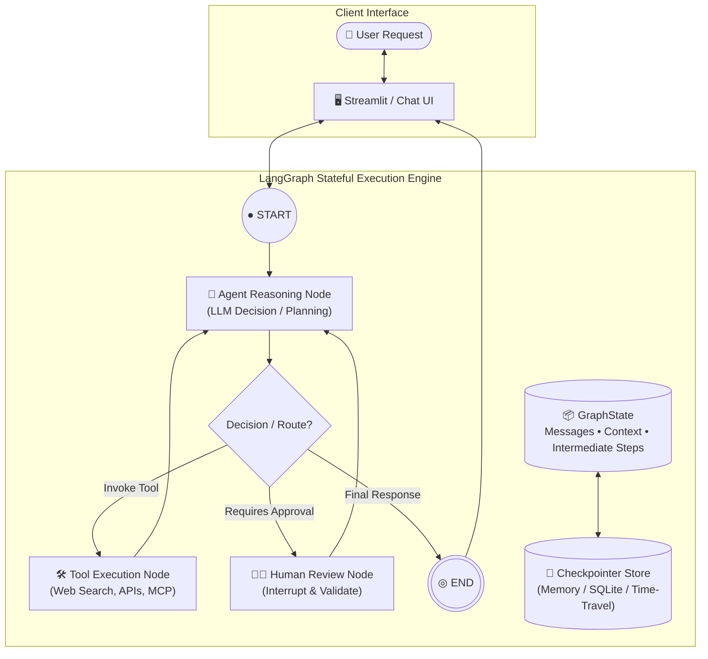

# 🧠 AgentForge: Agentic AI using LangGraph

### *Mastering Autonomous Systems, Cyclic Graphs & Production Agents*

 

  <b>A comprehensive laboratory and study repository tracking my deep dive into the  
  <a href="https://www.youtube.com/playlist?list=PLKnIA16_RmvbeN_1LspqecoxbK-tFzR-M">Agentic AI using LangGraph</a></b>

  <a href="#-architecture-paradigm">Architecture</a> •
  <a href="#-learning-journey-roadmap">Roadmap</a> •
  <a href="#-prerequisites">Prerequisites</a> •
  <a href="#-curriculum--syllabus">Curriculum</a> •
  <a href="#-resources--references">Resources</a>

---

## 🏛️ Architecture & Paradigm

Unlike traditional linear chains (DAGs), **LangGraph** enables cyclic multi-agent execution with durable state management, persistence, and human-in-the-loop controls.

---

## 🗺️ Roadmap

```mermaid
flowchart LR
    M1["<b>01. Foundations</b><br/>Agentic vs GenAI"] --> M2["<b>02. Workflows</b><br/>Sequential & Cyclic"]
    M2 --> M3["<b>03. State & UI</b><br/>Persistence & Streaming"]
    M3 --> M4["<b>04. Observability</b><br/>LangSmith Tracing"]
    M4 --> M5["<b>05. Tools & RAG</b><br/>MCP & Graph Retrieval"]
    M5 --> M6["<b>06. Control Flow</b><br/>HITL & Subgraphs"]
    M6 --> M7["<b>07. Memory</b><br/>Short & Long Term"]
    M7 --> M8["<b>08. Capstone Agents</b><br/>CRAG & Self-RAG"]
```

---

## 📑 Table of Contents

- [Architecture & Paradigm](#️-architecture--paradigm)
- [Learning Journey Roadmap](#️-learning-journey-roadmap)
- [Prerequisites](#-prerequisites)
- [Curriculum & Syllabus](#-curriculum--syllabus)
  - [Module 1: Foundations of Agentic AI](#module-1-foundations-of-agentic-ai)
  - [Module 2: Workflows in LangGraph](#module-2-workflows-in-langgraph)
  - [Module 3: Chatbots, Persistence & Streaming](#module-3-chatbots-persistence--streaming)
  - [Module 4: Observability with LangSmith](#module-4-observability-with-langsmith)
  - [Module 5: Tools, MCP & RAG](#module-5-tools-mcp--rag)
  - [Module 6: Advanced Control Flow](#module-6-advanced-control-flow)
  - [Module 7: Memory in LLM Agents](#module-7-memory-in-llm-agents)
  - [Module 8: Projects & Advanced RAG](#module-8-projects--advanced-rag)
- [Resources & References](#-resources--references)

---

## 🛠️ Prerequisites

| Category | Requirement | Description |
| :--- | :--- | :--- |
| **Language** | `Python >= 3.10` | Strong grasp of Object-Oriented Programming, async/await, and type hinting. |
| **GenAI Fundamentals** | Prompts & Embeddings | Understanding tokenization, system instructions, temperature, and semantic vector search. |
| **Model APIs** | Gemini / OpenAI | API access for LLM inference (`GEMINI_API_KEY` configured via `.env`). |
| **Observability** | LangSmith API Key | API token from LangChain for trace inspection, evaluation, and latency monitoring. |
| **Tools & Search** | Tavily / Serper | API credentials for dynamic web retrieval and agentic information search. |

---

## 📚 Curriculum & Syllabus

### Module 1: Foundations of Agentic AI
*Foundational concepts of agentic systems, graph-based orchestration, and core LangGraph primitives.*

- **Agentic AI using LangGraph: Playlist Introduction**  
  *Overview of the curriculum roadmap, architectural paradigms, and how LangGraph fits into modern autonomous software design.*
- **Generative AI vs Agentic AI**  
  *A deep dive into how passive prompt-response models differ from autonomous, goal-driven agents that proactively take actions.*
- **What is Agentic AI?**  
  *Understanding core agent architectures, decision loops (ReAct pattern), autonomy levels, and environment feedback mechanisms.*
- **LangChain vs LangGraph**  
  *Comparing linear DAG execution with cyclic graph architectures, explicit state management, and when to transition between them.*
- **LangGraph Core Concepts**  
  *Mastering the foundational building blocks: `State`, `Nodes`, `Edges`, `StateGraph`, and compilation into runnable workflows.*

---

### Module 2: Workflows in LangGraph
*Designing diverse workflow topologies to orchestrate deterministic and dynamic LLM executions.*

- **Sequential Workflows**  
  *Constructing linear step-by-step state graphs where outputs flow cleanly from one processing node to the next.*
- **Parallel Workflows**  
  *Branching graphs to execute independent tasks concurrently using fan-out and fan-in routing patterns.*
- **Conditional Workflows**  
  *Implementing dynamic routing decisions using conditional edges based on state evaluations.*
- **Iterative Workflows**  
  *Building cyclic feedback loops that allow models to inspect, validate, and refine answers until criteria are met.*

---

### Module 3: Chatbots, Persistence & Streaming
*Building production-grade conversational agents with memory, checkpoints, and user interfaces.*

- **Persistence in LangGraph and Time Travel**  
  *Leveraging state checkpointers to save conversation history and rewinding/forking past states with time travel.*
- **Building a Chatbot with UI using LangGraph and Streamlit**  
  *Connecting a stateful LangGraph backend to an interactive, user-friendly Streamlit web interface.*
- **Streaming in LangGraph**  
  *Streaming token-by-token LLM completions and intermediate graph node updates for responsive UX.*
- **Resume Chat Feature like ChatGPT**  
  *Managing thread identifiers to reload, resume, and switch between previous chat sessions effortlessly.*
- **LangGraph + SQLite: Chatbot with Database Integration**  
  *Persisting conversation checkpoints reliably to an SQLite relational database via `SqliteSaver`.*

---

### Module 4: Observability with LangSmith
*Monitoring, debugging, and evaluating agentic graphs in real time.*

- **LangSmith Crash Course for Beginners**  
  *Understanding LLM observability fundamentals: traces, runs, latency breakdowns, and token cost tracking.*
- **Observability in LangGraph: LangSmith Integration**  
  *Instrumenting complex state graphs with LangSmith to visualize node transitions, inputs/outputs, and edge conditions.*

---

### Module 5: Tools, MCP & RAG
*Supercharging agents with external capabilities, protocols, and factual knowledge retrieval.*

- **Tools in LangGraph**  
  *Defining custom Python tools, binding them to LLMs, and routing execution through `ToolNode`.*
- **How to Build an MCP Client using LangGraph**  
  *Integrating the Model Context Protocol (MCP) to seamlessly communicate with standardized external tool servers.*
- **RAG using LangGraph**  
  *Orchestrating stateful Retrieval-Augmented Generation workflows with document indexing, retrieval, and synthesis nodes.*

---

### Module 6: Advanced Control Flow
*Implementing human oversight and modular multi-agent architectures.*

- **Human in the Loop (HITL) using LangGraph**  
  *Interrupting graph execution at critical nodes to request human validation, feedback, or input before proceeding.*
- **How to Build Subgraphs in LangGraph**  
  *Creating clean, modular architectures by encapsulating isolated multi-step subgraphs within a parent graph.*

---

### Module 7: Memory in LLM Agents
*Understanding state preservation, conversational recall, and personalized agent storage.*

- **LLMs Don't Have Memory: So How Do They Remember?**  
  *Deconstructing the stateless nature of LLMs and how memory is simulated through context injection and store layers.*
- **Short Term Memory in LangGraph**  
  *Managing thread-scoped conversational state across turns using message reducers and checkpoint memory.*
- **Long Term Memory in LangGraph**  
  *Implementing cross-thread, namespace-based semantic memories to store persistent user preferences and profiles.*

---

### Module 8: Projects & Advanced RAG
*Building production-grade autonomous systems and resilient self-correcting RAG architectures.*

- **Blog Writing Agent: Plans, Researches & Writes Blogs Automatically**  
  *An end-to-end agentic project that orchestrates outline planning, web research, drafting, reviewing, and editing.*
- **Advanced RAG: Corrective RAG (CRAG)**  
  *A resilient RAG architecture that grades retrieved documents and triggers fallback web searches when retrieval is poor.*
- **Self-RAG: Making AI Fact-Check Itself**  
  *An advanced architecture that evaluates its own generated responses for hallucination, relevance, and factual grounding.*

---
